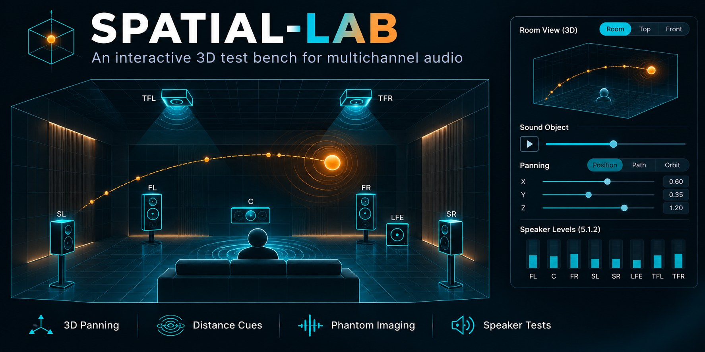
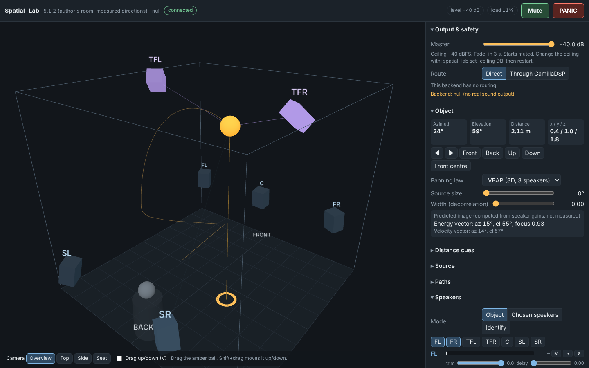
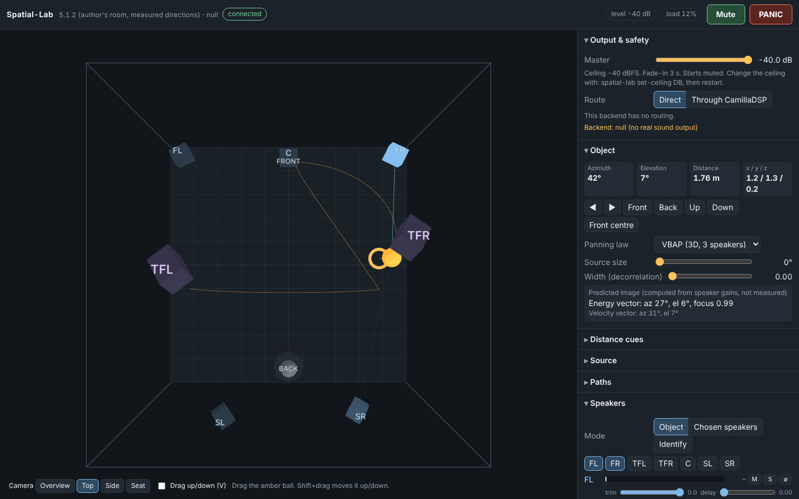
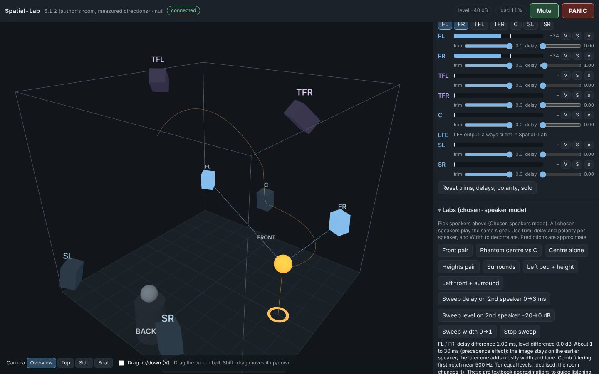
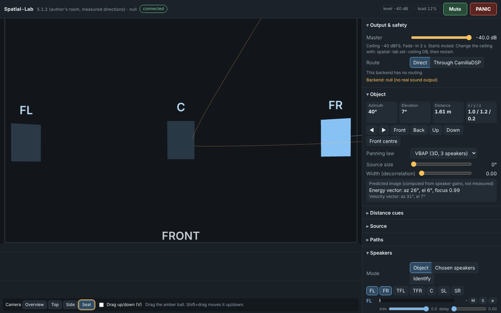
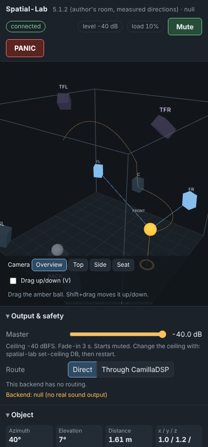

# Spatial-Lab

**Documentation: <https://praveenchandrahas.github.io/Spatial-Lab/>**

An interactive 3D test bench for a multichannel room. Open a page, drag a sound object around a model of
the room, and hear it move on the real speakers. Built for the author's 5.1.2 setup (Logitech Z906 bed, two ceiling
height speakers, 7.1 USB interface, CamillaDSP, PipeWire), but the layout is a file you can change.

It is one of the repositories of the [Software-Defined Home Theatre](https://github.com/praveenchandrahas/Software-Defined-Home-Theatre)
project (its [repository map](https://praveenchandrahas.github.io/Software-Defined-Home-Theatre/repos/)). Where the other
repositories tune and measure the room, this one is for listening to it: it moves a test sound around the real speakers on demand.
It needs none of the other repositories, but it shares their PipeWire and CamillaDSP setup and sits beside them
(`scripts/clone-all.sh` in the main repository clones it into the same folder).

It demonstrates:

- **Panning** in 3D (VBAP over the real speaker directions, or nearest-speaker for comparison), including height.
- **Distance cues**: level, air absorption and optional Doppler.
- **Phantom imaging** ("phasing"): per-speaker level, delay (0 to 50 ms) and polarity, with notes on summing
  localisation, the precedence effect and comb filtering.
- **Image width**: correlated vs decorrelated copies of the signal across the speakers.
- **Paths**: nine presets, drag-recording with replay, and a speed control.
- **Speaker identification**: plays each speaker in turn so you can prove the channel map.

Sound is made by a local Python engine, not by the browser. The page only draws and sends commands.

## Safety

- Starts **muted**. Unmute fades in over 3 s.
- Master level is clamped to a **ceiling of -40 dBFS** read from the config file at start-up. The page cannot raise it.
  Raise it by hand: `spatial-lab set-ceiling -30`, then restart.
- **Esc** or the PANIC button silences in 20 ms. **M** toggles mute.
- The engine mutes itself if the page stops responding for 4 s or the last page closes.
- The LFE output is always silent.
- The server listens on 127.0.0.1 only and rejects wrong Host/Origin headers.

Start with the amplifier volume low and raise the ceiling in small steps.

## Install

**From the .deb** (Ubuntu/Kubuntu 22.04 or newer, Debian 12 or newer): download `spatial-lab_*_all.deb` from the
[latest release](https://github.com/praveenchandrahas/Spatial-Lab/releases/latest), then

```
sudo apt install ./spatial-lab_0.1.0_all.deb     # pulls in numpy, scipy, aiohttp, yaml
spatial-lab check
spatial-lab serve --open
```

The package is pure Python and installs the `spatial-lab` command. The author installed it with `apt` on the rig
laptop (2026-11-08) and `spatial-lab check` ran correctly from the installed copy. Sound through it has not yet been
tried: the USB interface was not connected at that moment, so `serve` stopped with "cannot route to the USB interface".
Build the package yourself with `tools/build-deb.sh`.

**From source:**

```
sudo apt install python3-numpy python3-scipy python3-aiohttp python3-yaml ffmpeg pipewire-bin
git clone https://github.com/praveenchandrahas/Spatial-Lab && cd Spatial-Lab
python3 -m spatial_lab check          # what it can see
python3 -m spatial_lab serve --open   # then use the page
```

(`pip install -e .` also works and adds the `spatial-lab` command. `python3-matplotlib` adds plots to `render`.)

## First run checklist

1. `spatial-lab check`: the USB sink should show `present`; CamillaDSP `present` if you want Through mode.
   Stop mpv or anything else playing first.
2. Start with **Direct** and a low master. Press **Unmute**.
3. Set mode **Identify**: each speaker should sound in turn, in the order FL, FR, TFL, TFR, C, SL, SR.
   Check that the height speakers are the ceiling ones. If an order is wrong, edit the layout file's `port` values.
4. Back to **Object** mode, press **Front centre**, then play a path.
5. Switch to **Through CamillaDSP** and compare. Expect differences: CamillaDSP adds bass management, EQ, its own
   delays and trims. In Through mode distance alignment is off by default because CamillaDSP already aligns.

## Screenshots

These are real renders of the page, not mock-ups, taken headless with `--backend null` (no audio device, so
**no sound was played and none is shown**). The numbers on screen, such as the predicted image direction, are
computed by the engine from the speaker gains. They are predictions, not microphone measurements, and these are
not photos of the author's room. Regenerate them with `node tools/screenshots.js`.



*Overview camera. The object sits on the `height_arc` path; blue rays show which speakers are driven.*



*Top camera, Object mode: a three-speaker VBAP mix with the predicted energy and velocity vectors.*



*Chosen speakers with a 1.00 ms delay on FR, and the Labs note on the precedence effect and comb notch.*



*Seat camera, looking at the front wall from the listening position.*



*The same page at phone width.*

## Using the page

- Drag the amber ball. Shift+drag (or the "Drag up/down" box, key V) moves it vertically.
- Keys: M mute, Esc panic, Space path, arrows move front/back/left/right, PageUp/PageDown up/down,
  1 to 4 cameras, I identify.
- **Chosen speakers** mode plays one signal from the speakers you pick. Use trim, delay and polarity per speaker
  and the Labs buttons to hear phantom images, precedence and comb filtering.
- Source: pink noise (default, high-passed at 200 Hz so the satellites get no bass) or any audio file ffmpeg can read.

## Offline renders

`spatial-lab render --path lap --out renders` writes an 8-channel WAV, one WAV per speaker and a plot of intended
vs predicted image direction and speaker gains. Nothing is played.

## What has and has not been tested

Tested (automated, 30 tests, plus a headless browser run):

- VBAP maths, pink-noise spectrum, fractional delay, decorrelation, level ceiling, fade-in, panic, watchdog,
  LFE silence, polarity flip, delay, alignment ordering, distance falloff, identify cycling.
- Server security (Host/Origin rejection, path traversal), uploads, recordings, commands.
- The page loads, connects, shows live readouts, and dragging moves the object.

**Not tested** (needs the real rig):

- Real audio through PipeWire: `pw-cat` start-up, the explicit links to the USB sink and to CamillaDSP, and the
  route switch. The code follows the pattern of the author's `tone-test.sh` (in Roomtone), but it has not been run against the real PipeWire graph yet.
- Whether anything sounds right. All "predicted image" values are calculated, not measured.
- Mic-based verification is deferred.

## Known limitations and assumptions

- **Surround distance.** The author's rough figure is about 3 ft to each surround, but the CamillaDSP delay and trim for them suggest
  nearer 5 ft. The layout file uses 3 ft; measure and correct it. It only affects the 3D drawing and alignment.
- **Heights' distance, ceiling height and seat-to-back-wall are guesses** (marked `provisional`).
- Both height speakers are ahead of the seat, so an object straight overhead lands on TFL+TFR plus the surrounds.
  Height is level-only: there are no spectral height cues.
- Air absorption and Doppler are nearly inaudible at room scale. The multiplier controls exist so you can hear them.
- The Z906 still sends bass from the satellites to its sub, so the 200 Hz high-pass on the source matters.
- A browser tab left in the background for several minutes may have its timers throttled enough to trip the
  watchdog. The result is a mute, never a loud sound.

## Layout and config

- Layout: `spatial_lab/layouts/author-5.1.2.yml`; override with `~/.config/spatial-lab/layout.yml`,
  `$SPATIAL_LAB_LAYOUT` or `--layout`.
- Config: `~/.config/spatial-lab/config.yml` (ceiling, fade-in, port, high-pass).
- Recordings: `~/.local/share/spatial-lab/recordings`.

See `docs/design.md` for how it works. Licence: Apache-2.0. The vendored three.js is MIT (see `spatial_lab/web/vendor`).
